<p align="center">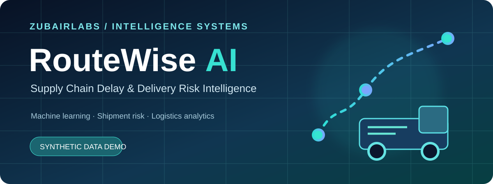</p>

<h1 align="center">RouteWise AI</h1>

<p align="center"><strong>Supply chain delay prediction, shipment risk analytics and what-if simulation</strong><br/>
An end-to-end machine-learning portfolio project by <a href="https://zubairlabs.com">ZubairLabs</a>, built on clearly labelled synthetic data.</p>

<p align="center">
  <a href="https://routewise-ai-zubairlabs.streamlit.app"></a>
  <a href="https://github.com/muhammadzubair-data/routewise-ai-supply-chain-intelligence/actions/workflows/ci.yml"></a>
  
  
  
  
  
  
</p>

<p align="center">
  <a href="#live-demo">Live demo</a> ·
  <a href="#key-features">Features</a> ·
  <a href="#model-evaluation-results">Results</a> ·
  <a href="#dashboard-screenshots">Screenshots</a> ·
  <a href="#installation">Install</a> ·
  <a href="#limitations">Limitations</a>
</p>

> [!IMPORTANT]
> **Educational prototype, not a production logistics system.** Every shipment and every outcome in this project is generated by a documented formula in [`routewise/core.py`](routewise/core.py). The metrics below describe how well the model recovers that simulated pattern. They say nothing about real-world delivery accuracy, and no logistics cost savings are claimed. There is no carrier API, GPS feed or live tracking.

## Contents

1. [Introduction](#introduction)
2. [Business problem and solution](#business-problem-and-solution)
3. [Key features](#key-features)
4. [Architecture](#architecture)
5. [Machine-learning workflow](#machine-learning-workflow)
6. [Data pipeline](#data-pipeline)
7. [Dataset documentation](#dataset-documentation)
8. [Technology stack](#technology-stack)
9. [Dashboard screenshots](#dashboard-screenshots)
10. [Model evaluation results](#model-evaluation-results)
11. [Installation](#installation)
12. [Usage guide](#usage-guide)
13. [Deployment on Streamlit Community Cloud](#deployment-on-streamlit-community-cloud)
14. [Automated testing](#automated-testing)
15. [Project structure](#project-structure)
16. [Limitations](#limitations)
17. [Roadmap](#roadmap)
18. [Author](#author)

## Live demo

**https://routewise-ai-zubairlabs.streamlit.app**

Deployed on Streamlit Community Cloud (Python 3.12) and checked in a browser on 21 November 2026: all six pages load, a prediction returns 68.0% for the default shipment, sidebar filters update the risk list, and the what-if customs toggle moves the estimate from 16.5% to 27.9%. These live results match the local test run.

The app trains its model on first load (a few seconds), then caches it. If the app has been idle, Streamlit may show a short "waking up" screen first.

## Introduction

RouteWise AI estimates the probability that a shipment will arrive late, **using only what is known at the moment it is dispatched**. It then turns those estimates into a working tool: a command center for the whole network, a single-shipment predictor, a prioritised risk list, a what-if simulator and a full model report.

The project is deliberately honest about its data. It uses a seeded synthetic generator so anyone can reproduce every number, and it shows its evaluation choices openly, including the ones that make the score look worse.

## Business problem and solution

**The problem.** Operations teams usually learn a shipment is late after it is late. By then the options are expensive: expedite, apologise, or absorb a penalty. What they want at dispatch time is a ranked list: which shipments are most likely to slip, and why.

**The solution demonstrated here.**

| Need | How RouteWise addresses it |
|:--|:--|
| Know the risk before it happens | A classifier trained only on dispatch-time inputs (booking details, forecasts, carrier history) |
| Focus limited attention | Risk bands, a priority score weighted by service level, and a sortable, downloadable risk list |
| Understand the "why" | Per-shipment driver chart, permutation importance and a tornado chart of feature effects |
| Plan interventions | A what-if simulator: change the carrier, mode, backlog or customs status and see the estimate move |
| Trust the numbers | Temporal holdout, cross-validated model choice, calibration curve and an explicit leakage check |

## Key features

| Page | What you can do |
|:--|:--|
| **Command Center** | KPIs, monthly volume with observed vs predicted delay rates (holdout period shaded), risk-band mix, predicted vs observed by band, delay drivers by mode, priority, weather and distance |
| **Delay Prediction** | Enter a shipment's dispatch-time details and get a probability, a risk band, a recommended action at the tuned threshold, and the factors moving the estimate. Inputs are validated; values outside the training range trigger a warning |
| **Risk Explorer** | Search by shipment ID, filter by band, period and minimum risk, set business weights for Standard / Express / Critical, and export the ranked list as CSV |
| **What-If Simulator** | Start from a typical shipment or any of the 300 riskiest, change inputs, compare baseline and scenario, view a sensitivity curve and a tornado chart |
| **Model Performance** | Candidate comparison, temporal vs random split, leakage check, PR and ROC curves, confusion matrices at 0.50 and at the tuned threshold, calibration, permutation importance, classification report |
| **Data Explorer** | Feature-availability table (what is known at dispatch and what is not), data-quality report, distributions, filtered table, and three downloads (filtered CSV, full dataset, evaluation JSON) |

Also included: light and dark themes (navy, cyan, teal and electric-blue palette), sidebar filters shared across pages, adjustable dataset size (2,000 to 20,000 shipments) and seed, and CSV exports protected against spreadsheet formula injection.

## Architecture

<p align="center"></p>

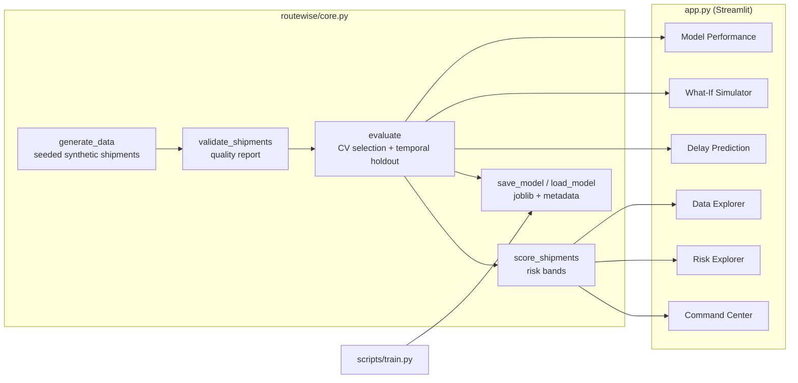

## Machine-learning workflow

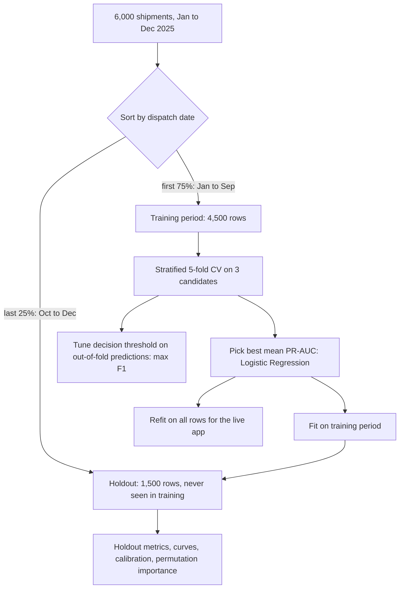

**Design choices, and why**

- **Only dispatch-time features.** Eleven inputs: booking details, forecasts and carrier history. The four outcome columns (`delayed`, `delay_days`, `actual_transit_days`, `customs_hold_hours`) and the IDs are never model inputs. A test enforces this.
- **Leakage removed from the original version.** The first version of this project fed `customs_hold_hours` to the model. Hold hours are only known after the shipment reaches customs, so the feature was replaced by `customs_clearance_required`, which is known at booking. The Model Performance page shows what the leak would have added (PR-AUC 0.531 to 0.558).
- **Temporal holdout instead of a random split.** The model is tested on the last quarter, which it has never seen and which includes the November and December peak. This is the realistic question: "trained on the past, how does it do on the next months?"
- **Model chosen by cross-validation, not by the test set.** Three candidates are compared on the training period only. Logistic Regression wins on PR-AUC and has the best-calibrated probabilities.
- **Threshold tuned without touching the holdout.** The 0.214 cut-off comes from out-of-fold training predictions.
- **No in-sample scores in the dashboard.** Training-period shipments show their out-of-fold estimate; holdout shipments show the estimate from the model that never saw them. Without this, the dashboard would look better than the model really is.
- **Imbalance handled by threshold, not by reweighting.** About 20% of shipments are delayed. A balanced Random Forest was tried; it raised recall at 0.5 but gave worse PR-AUC and poorly calibrated probabilities (Brier 0.167 vs 0.126). Tuning the threshold on well-calibrated probabilities works better here.

## Data pipeline

<p align="center"></p>

## Dataset documentation

The data is produced by `generate_data(n=6000, seed=42)`. Dispatch dates run through 2025. Weather forecasts are worse in winter and warehouse backlog peaks in November and December, so the holdout quarter is genuinely harder than the training period. About 1.5% of `traffic_index` and 0.75% of `carrier_on_time_rate` values are blanked to exercise imputation.

**Model inputs: known at dispatch**

| Column | Type | Range / values | Meaning |
|:--|:--|:--|:--|
| `distance_km` | float | 1 to 20,000 | Route distance (booking) |
| `planned_days` | int | 1 to 60 | Planned transit days (booking) |
| `weight_kg` | float | 0.1 to 50,000 | Shipment weight (booking) |
| `weather_severity` | int | 0 to 5 | Weather forecast severity at dispatch |
| `traffic_index` | float | 0 to 100 | Traffic / congestion forecast at dispatch |
| `warehouse_backlog` | int | 0 to 100 | Origin warehouse backlog at dispatch |
| `carrier_on_time_rate` | float | 0 to 1 | Carrier's historical on-time rate |
| `customs_clearance_required` | 0/1 | 0, 1 | Whether the route needs customs clearance (booking) |
| `transport_mode` | category | Road, Rail, Air, Sea | Mode (booking) |
| `region` | category | North, South, East, West, Central | Destination region |
| `priority` | category | Standard, Express, Critical | Service level |

**Outcomes: only known after delivery (never model inputs)**

| Column | Meaning |
|:--|:--|
| `delayed` | Target: 1 if the shipment arrived late |
| `delay_days` | Days late (0 if on time) |
| `actual_transit_days` | Planned days plus delay |
| `customs_hold_hours` | Realised customs hold; used only in the leakage demonstration |

**Identifiers:** `shipment_id` (e.g. `RW-000123`), `dispatch_date`.

**How the label is simulated.** A logistic formula combines the *realised* weather (the forecast plus noise), traffic, backlog, carrier on-time rate, realised customs hold, distance, Sea mode and service priority. The label is then sampled from that probability. Because the realised weather and hold are not visible at dispatch, even a perfect model cannot reach 100%, which is what real delay prediction looks like.

A 150-row sample is included at [`sample_data/demo_shipments.csv`](sample_data/demo_shipments.csv). Validation (`validate_shipments`) drops rows with unknown categories or out-of-range values and reports them; missing values are kept for the pipeline to impute.

## Technology stack

| Layer | Tools |
|:--|:--|
| Language | Python 3.11 / 3.12 |
| Data | pandas, NumPy |
| Machine learning | scikit-learn (Pipeline, ColumnTransformer, LogisticRegression, RandomForestClassifier, StratifiedKFold, permutation_importance, calibration_curve) |
| Persistence | joblib bundle with model, threshold, features, sklearn version and holdout metrics |
| Dashboard | Streamlit multipage app (`st.navigation`), custom light and dark themes |
| Charts | Plotly |
| Testing | pytest, Streamlit AppTest, Playwright browser checks |
| CI | GitHub Actions: Python 3.11 and 3.12 matrix plus an end-to-end browser job |

No paid APIs, no API keys, no external datasets.

## Dashboard screenshots

All screenshots are real captures of this app running locally (1440 px wide, default settings: 6,000 shipments, seed 42).

**Command Center (light)**

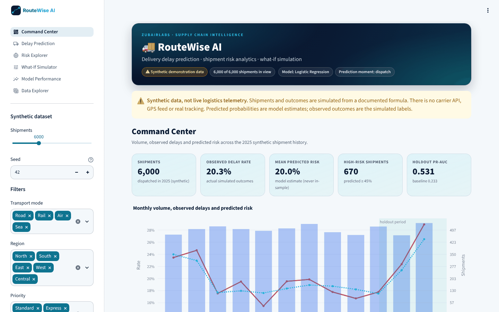

<table>
<tr>
<td width="50%"><strong>Command Center (dark)</strong><br/>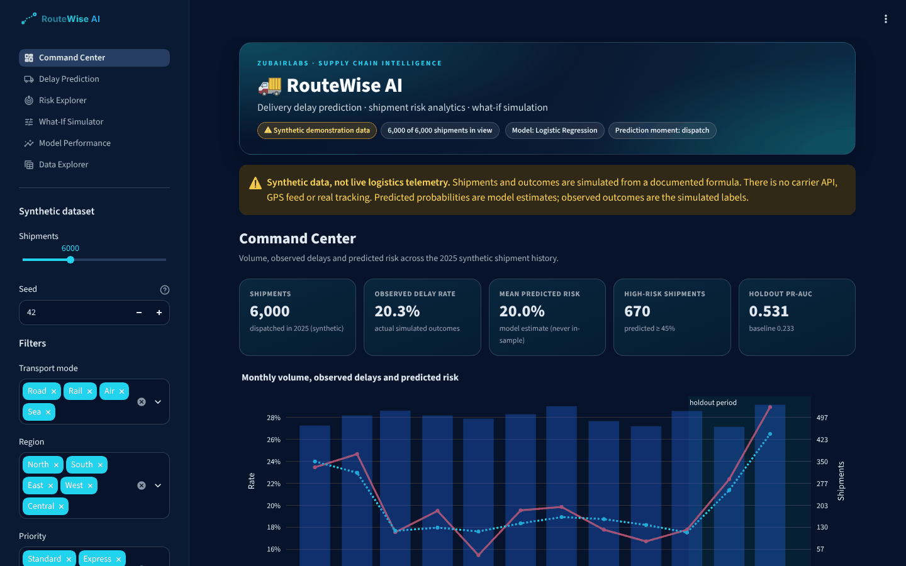</td>
<td width="50%"><strong>Delay drivers (dark)</strong><br/>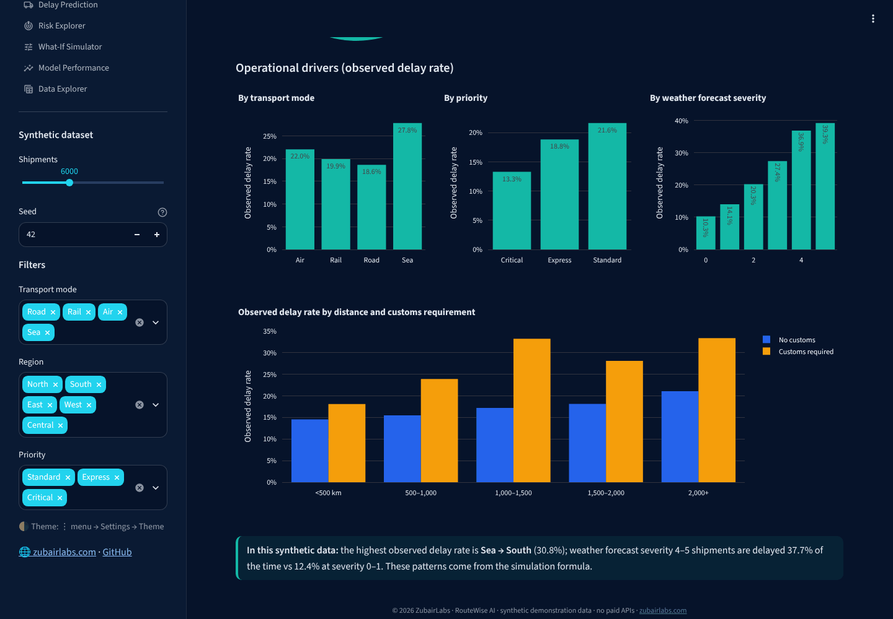</td>
</tr>
<tr>
<td><strong>Delay Prediction result</strong><br/>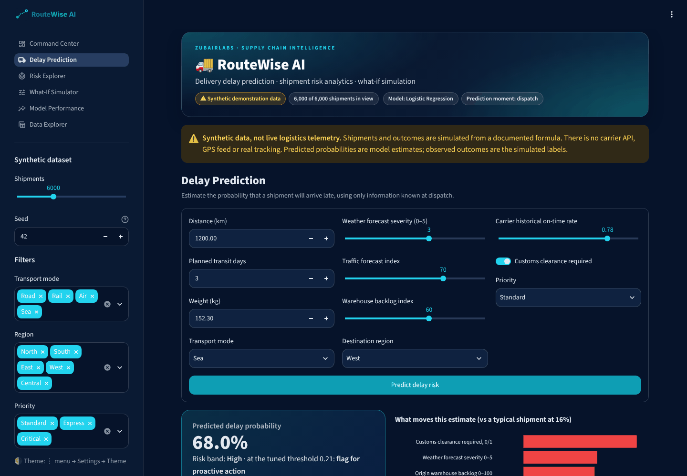</td>
<td><strong>Delay Prediction form (light)</strong><br/>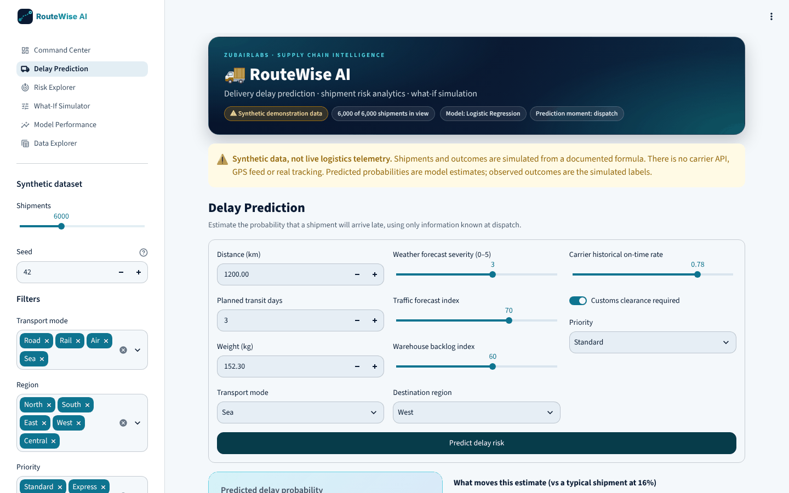</td>
</tr>
<tr>
<td><strong>Risk Explorer (dark)</strong><br/>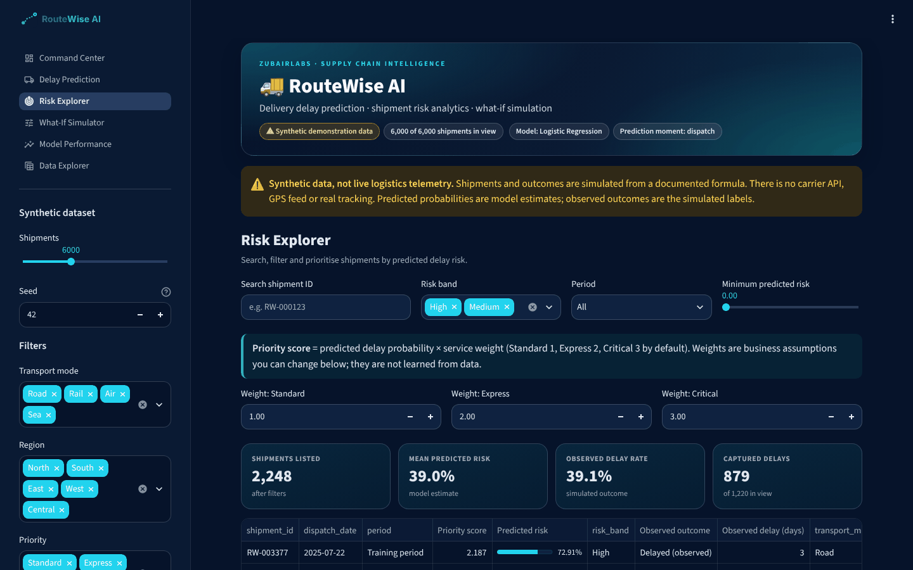</td>
<td><strong>Risk Explorer (light)</strong><br/>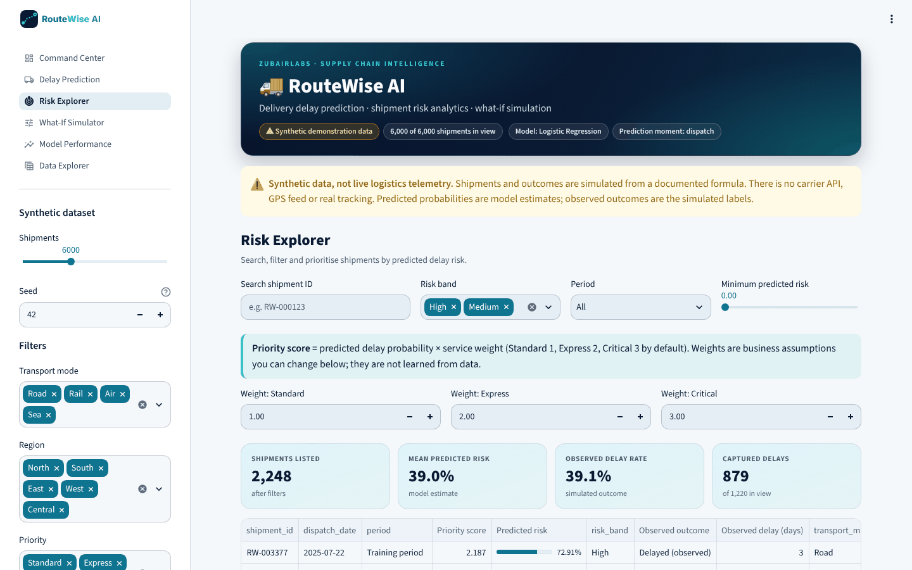</td>
</tr>
<tr>
<td><strong>What-If Simulator</strong><br/>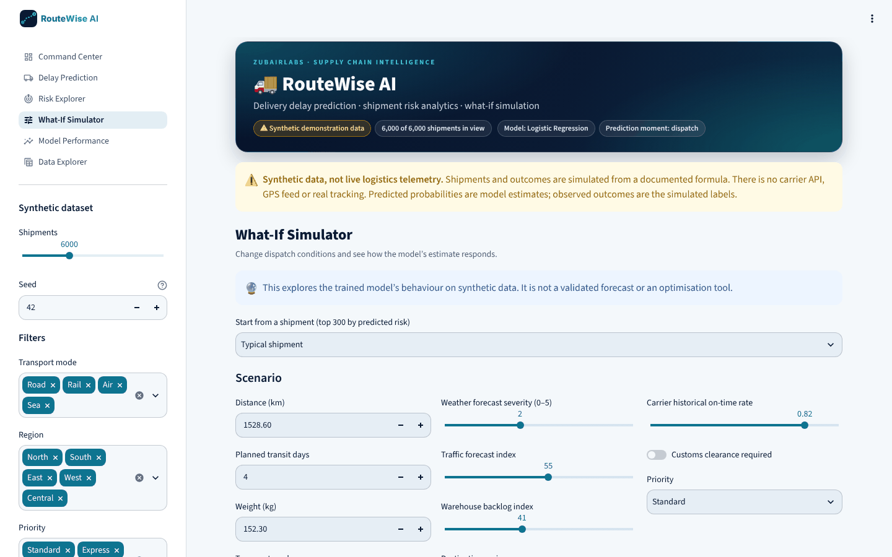</td>
<td><strong>Sensitivity curve and tornado chart</strong><br/>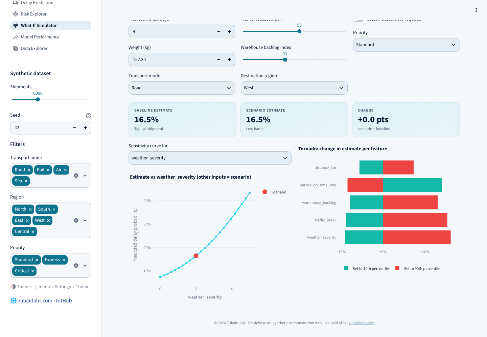</td>
</tr>
<tr>
<td><strong>Model Performance</strong><br/>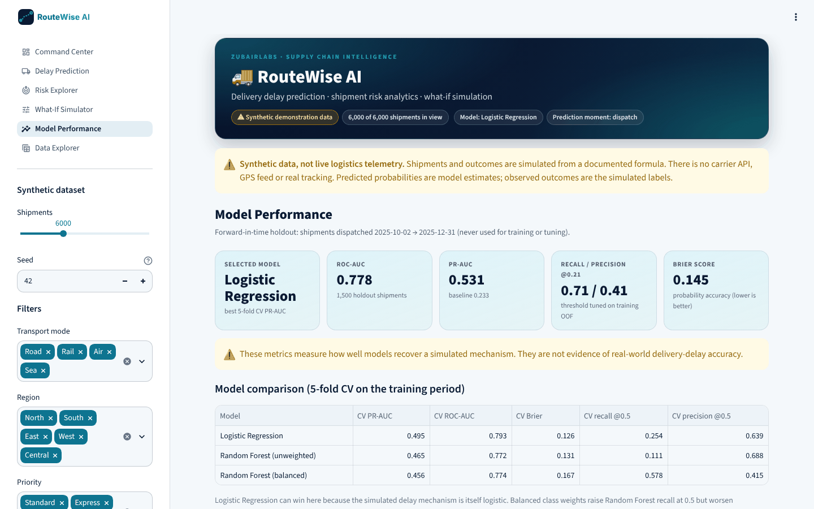</td>
<td><strong>Curves, confusion matrices, calibration</strong><br/>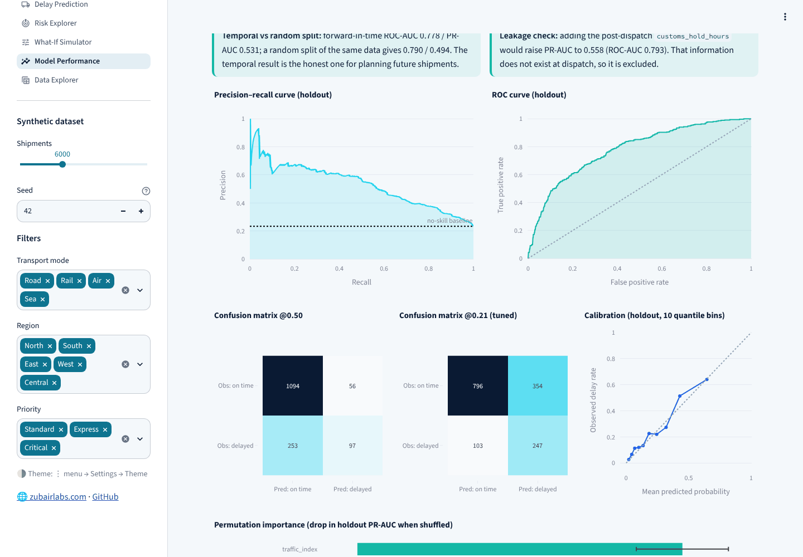</td>
</tr>
<tr>
<td><strong>Model Performance (dark)</strong><br/>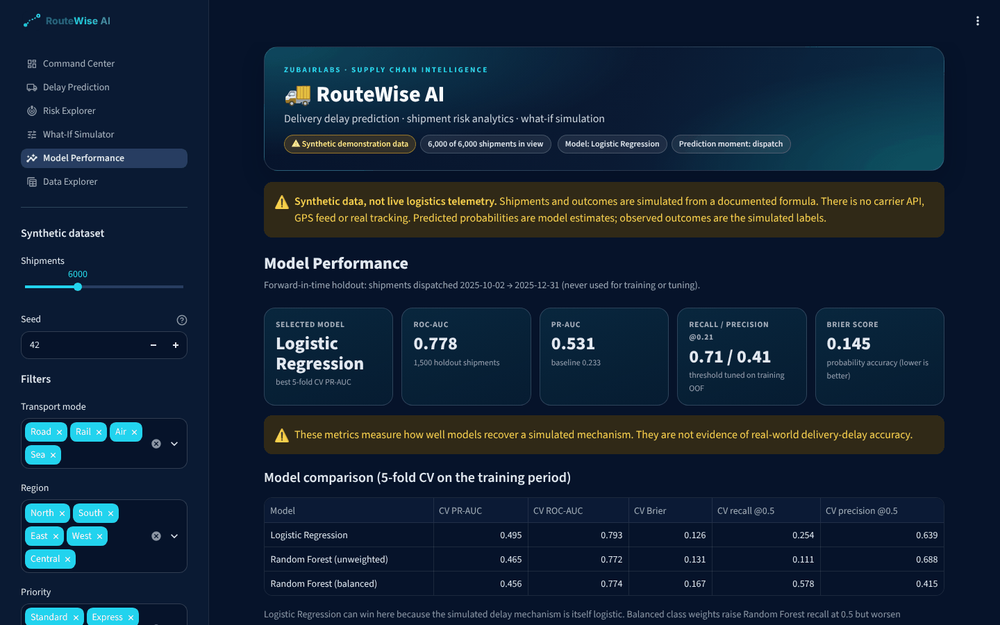</td>
<td><strong>Data Explorer (dark)</strong><br/>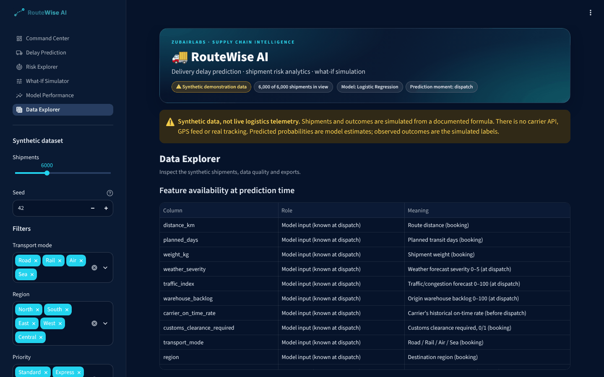</td>
</tr>
</table>

## Model evaluation results

Measured by running the code in this repository (`python scripts/train.py`, 6,000 synthetic shipments, seed 42, scikit-learn 1.x). The app recomputes these on load; nothing is hard-coded. **These are results on simulated data and are not evidence of real-world performance.**

**Candidate comparison: stratified 5-fold CV on the training period (Jan to Sep, 4,500 rows)**

| Model | PR-AUC | ROC-AUC | Brier | Recall @0.5 | Precision @0.5 |
|:--|--:|--:|--:|--:|--:|
| **Logistic Regression (selected)** | **0.495** | **0.793** | **0.126** | 0.254 | 0.639 |
| Random Forest (unweighted) | 0.465 | 0.772 | 0.131 | 0.111 | 0.688 |
| Random Forest (balanced, original model) | 0.456 | 0.774 | 0.167 | 0.578 | 0.415 |

**Temporal holdout: Oct 2 to Dec 31 2025, 1,500 shipments, 23.3% delayed**

| Metric | Value |
|:--|--:|
| ROC-AUC | 0.778 |
| PR-AUC (average precision) | 0.531 (no-skill baseline 0.233) |
| Brier score | 0.145 |

| Decision threshold | Precision | Recall | F1 | TN | FP | FN | TP |
|:--|--:|--:|--:|--:|--:|--:|--:|
| 0.50 (default) | 0.634 | 0.277 | 0.386 | 1,094 | 56 | 253 | 97 |
| **0.214 (tuned on training OOF)** | 0.411 | **0.706** | **0.520** | 796 | 354 | 103 | 247 |

At the tuned threshold the model catches about 7 in 10 late shipments in the unseen quarter, at the cost of roughly 1.4 false alarms per correct flag. Which trade-off is right depends on what a false alarm costs, so the app shows both.

**Sanity checks**

| Check | ROC-AUC | PR-AUC | Takeaway |
|:--|--:|--:|:--|
| Temporal holdout (reported) | 0.778 | 0.531 | Honest forward-in-time estimate |
| Random 75/25 split | 0.790 | 0.494 | Different period mix; the two splits answer different questions |
| Same model plus post-dispatch `customs_hold_hours` | 0.793 | 0.558 | The gain a leak would give; excluded because it is unknown at dispatch |

**Calibration by risk band (all 6,000 shipments, never-in-sample scores)**

| Band | Shipments | Mean predicted | Observed delay rate |
|:--|--:|--:|--:|
| Low (< 20%) | 3,752 | 8.6% | 9.1% |
| Medium (20 to 45%) | 1,578 | 30.4% | 30.6% |
| High (≥ 45%) | 670 | 59.4% | 59.1% |

**Permutation importance (drop in holdout PR-AUC when the feature is shuffled):** traffic forecast 0.109, weather forecast 0.101, carrier on-time rate 0.096, warehouse backlog 0.086, customs required 0.029, distance 0.023, transport mode 0.009, priority 0.006; planned days, weight and region about 0. This matches the generator: those last three have no effect in the simulation, and the model correctly finds nothing there.

More detail in the [model card](docs/MODEL_CARD.md).

## Installation

Requirements: Python 3.11 or 3.12.

```bash
git clone https://github.com/muhammadzubair-data/routewise-ai-supply-chain-intelligence.git
cd routewise-ai-supply-chain-intelligence
python -m venv .venv
# Windows: .venv\Scripts\activate
# macOS / Linux: source .venv/bin/activate
python -m pip install -r requirements.txt
streamlit run app.py
```

Open the address Streamlit prints (usually `http://localhost:8501`). The first load trains the model in a few seconds; after that it is cached.

## Usage guide

1. **Start at the Command Center.** Use the sidebar to filter by mode, region and priority. Every page respects these filters.
2. **Score one shipment** on *Delay Prediction*: fill in the dispatch-time details and press **Predict delay risk**. The result shows the probability, band and recommended action, plus a chart of what moves this estimate compared with a typical shipment.
3. **Build a work list** on *Risk Explorer*: pick bands and a minimum risk, adjust service weights if Express or Critical failures cost more to you, then download the CSV.
4. **Test an intervention** on *What-If Simulator*: load one of the riskiest shipments, switch carrier reliability, mode or customs, and compare baseline vs scenario.
5. **Check the model** on *Model Performance* before trusting any of the above.
6. **Change the data**: the sidebar lets you regenerate with 2,000 to 20,000 shipments or a different seed. Everything retrains and every number updates.
7. **Theme**: switch light or dark from the app menu (⋮ → Settings → Theme).

**Train and save a model from the command line**

```bash
python scripts/train.py                         # 6,000 shipments, seed 42
python scripts/train.py --n 10000 --seed 7 --out artifacts
```

This writes `artifacts/routewise_model.joblib` (model, threshold, features, risk bands, sklearn version, holdout metrics) and `artifacts/metrics.json`. Load it with:

```python
from routewise.core import load_model, validate_input
bundle = load_model("artifacts/routewise_model.joblib")
row = validate_input({"distance_km": 1200, "planned_days": 3, "weight_kg": 150,
                      "weather_severity": 3, "traffic_index": 70, "warehouse_backlog": 60,
                      "carrier_on_time_rate": 0.78, "customs_clearance_required": 1,
                      "transport_mode": "Sea", "region": "West", "priority": "Standard"})
print(bundle["model"].predict_proba(row)[0, 1])
```

## Deployment on Streamlit Community Cloud

1. Fork or push this repository to GitHub.
2. Go to [share.streamlit.io](https://share.streamlit.io) and choose **Create app → Deploy a public app from GitHub**.
3. Select the repository, branch `main` and main file `app.py`.
4. Under **Advanced settings**, choose Python 3.12. No secrets are needed.
5. Optionally set a custom subdomain, then deploy.

The app needs no database, no credentials and no persistent storage. Data and models live in Streamlit's in-memory cache, and `.streamlit/config.toml` carries both themes.

## Automated testing

```bash
python -m pytest -q                       # 26 tests: data, pipeline, leakage guards, persistence, app start-up
python -m compileall -q app.py routewise scripts tests
```

Browser end-to-end check (opens all six pages in light and dark themes, submits a prediction, toggles a what-if input and verifies four downloads):

```bash
pip install -r requirements-dev.txt
python -m playwright install chromium
streamlit run app.py &                    # in another terminal
python tests/e2e_ui.py http://localhost:8501
```

What the tests cover:

| Area | Examples |
|:--|:--|
| Data | Reproducibility, realistic ranges and delay rate, sample CSV matches the generator |
| Leakage | No outcome or ID column in model inputs; temporal split puts the holdout strictly after training |
| Evaluation | All outputs present; dashboard scores are never in-sample; threshold within (0, 1) |
| Validation | Bad rows dropped with reasons, missing values kept; `validate_input` reports every problem |
| Behaviour | Higher weather, traffic or backlog raises the estimate; better carriers lower it |
| Persistence | Save / load round-trip gives identical predictions; mismatched features are rejected |
| App | Streamlit AppTest start-up without exceptions; Playwright checks every page, charts and downloads |

GitHub Actions runs the test job on Python 3.11 and 3.12 and then the browser job on every push to `main` and on pull requests. Latest local run: **26 passed**, E2E **OK**.

## Project structure

```text
routewise-ai-supply-chain-intelligence/
├── app.py                        # Streamlit multipage dashboard (6 pages)
├── routewise/
│   ├── __init__.py
│   └── core.py                   # Generator, validation, evaluation, scoring, persistence
├── scripts/
│   └── train.py                  # CLI: train, evaluate, save model + metrics
├── tests/
│   ├── conftest.py
│   ├── test_core.py              # Original tests (kept, still passing)
│   ├── test_pipeline.py          # Pipeline, leakage, validation, persistence, app tests
│   └── e2e_ui.py                 # Playwright browser checks and screenshots
├── sample_data/
│   └── demo_shipments.csv        # 150-row reproducible sample
├── assets/
│   ├── hero.svg, architecture.svg, data-pipeline.svg
│   ├── logo.svg, icon.svg
│   └── screenshots/              # Real app screenshots
├── docs/
│   ├── MODEL_CARD.md
│   └── PORTFOLIO.md
├── .streamlit/config.toml        # Light and dark themes
├── .github/workflows/ci.yml
├── requirements.txt
├── requirements-dev.txt
├── LICENSE
└── README.md
```

## Limitations

- **Synthetic data only.** The relationships the model learns were written into the generator. Real shipments have messier signals, missing context, and drift that this project cannot represent.
- **No real-world accuracy or savings claim.** Holdout metrics measure recovery of a simulated pattern. Any operational benefit would need validation on real, licensed data.
- **Forecast features are assumed available.** Weather and traffic "forecasts" are simulated. In practice their quality and timing vary by source.
- **One time-based holdout.** A single quarter is tested; a production system would need rolling back-tests, monitoring for drift and periodic retraining.
- **Risk bands and service weights are business assumptions**, not optimised against real costs.
- **Feature effects are associations** inside a simulation, not causal effects. The what-if simulator shows how the model responds, not what would really happen.
- **No integrations.** There is no carrier API, GPS feed, TMS connection, authentication or multi-user storage.

## Roadmap

- [ ] Validate on an appropriately licensed real-world shipment dataset
- [ ] Rolling-origin back-testing across several quarters
- [ ] Gradient-boosted model with monotonic constraints, compared against the current baseline
- [ ] Cost-sensitive threshold selection from user-supplied false-alarm and miss costs
- [ ] Per-shipment explanations (SHAP) alongside the current reset-to-reference view
- [ ] Drift monitoring on input distributions
- [x] Temporal holdout and leakage audit
- [x] Probability calibration check and threshold analysis
- [x] Real application screenshots after browser verification

## Author

**Muhammad Zubair** · ZubairLabs
Data analytics, machine learning and BI dashboards for startups and SMEs.

[zubairlabs.com](https://zubairlabs.com) · [GitHub](https://github.com/muhammadzubair-data) · [LinkedIn](https://www.linkedin.com/in/xubbiofficial/) · [Upwork](https://www.upwork.com/freelancers/xubbiofficial)

**License:** MIT. See [LICENSE](LICENSE).
