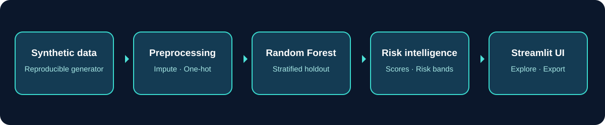
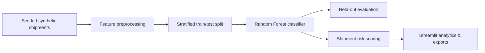

<p align="center"></p>

<h1 align="center">🚚 RouteWise AI</h1>
<p align="center"><strong>Supply Chain Delay & Delivery Risk Intelligence</strong><br/>A reproducible, interactive machine-learning portfolio project by <a href="https://zubairlabs.com">ZubairLabs</a>.</p>
<p align="center">    <a href="https://github.com/muhammadzubair-data/routewise-ai-supply-chain-intelligence/actions/workflows/ci.yml"></a> </p>

> [!IMPORTANT]
> **Educational prototype, not a production logistics system.** All shipments and labels are synthetically generated. The model is trained and evaluated on synthetic data; its metrics do not establish real-world delivery-delay accuracy. No live shipment tracking, guaranteed ETA, or operational route optimization is provided.

## ✨ Project overview

Delivery disruptions can be expensive and difficult to prioritize. RouteWise AI demonstrates an end-to-end analytics workflow: generate synthetic shipment records, train a delay classifier, compare holdout metrics, explore shipment risk, and interactively change operational inputs. **No API keys, paid APIs, or external datasets required.**

### Dashboard features

| Area | What you can do |
|---|---|
| 📊 Command Center | Explore shipment counts, synthetic delay rates, risk bands, and mode-level analytics |
| 🚨 Risk Explorer | Filter scored shipments by region and risk band; download risk reports |
| 🔮 What-if Simulator | Adjust distance, traffic, weather, backlog, carrier reliability, and other inputs |
| 🧠 Model Evaluation | View actual held-out ROC-AUC, average precision, confusion matrix, and classification report |
| 📁 Data & Exports | Browse synthetic records and export datasets and predictions as CSV |
| ℹ️ Methodology | Inspect assumptions, dataset provenance, limitations, and validation roadmap |

## 🧭 System architecture

<p align="center"></p>



## 🧪 Machine-learning methodology

- **Task:** Binary classification of a simulated delayed-delivery label.
- **Features:** distance, planned days, shipment weight, weather severity, traffic index, warehouse backlog, carrier on-time rate, known customs hold, mode, region, and priority.
- **Preprocessing:** numeric median imputation; categorical most-frequent imputation and one-hot encoding; a unified scikit-learn `Pipeline`.
- **Estimator:** Random Forest (`n_estimators=160`, `min_samples_leaf=5`, `class_weight='balanced'`, `random_state=42`).
- **Evaluation:** stratified random 75/25 holdout; ROC-AUC, average precision, classification report, and confusion matrix. Metrics are **computed at runtime**, never hard-coded.
- **Risk tiers:** low < 0.30, medium 0.30–0.60, high > 0.60. These are **illustrative thresholds**, not optimized or calibrated operational cutoffs.
- **Leakage prevention:** shipment ID and the target are excluded from model inputs. This is a synthetic cross-sectional example, not a temporal backtest.

### Synthetic data generation

The dataset generator in `routewise/core.py` uses a seeded NumPy RNG and a simulated logistic delay mechanism influenced by weather, traffic, warehouse backlog, carrier historical performance, customs hold, distance, mode, and priority. The binary label is sampled from this simulated probability. The labels and relationships are **fabricated for education**, not derived from actual logistics operations.

## 🚀 Quick start

```bash
git clone https://github.com/muhammadzubair-data/routewise-ai-supply-chain-intelligence.git
cd routewise-ai-supply-chain-intelligence
python -m venv .venv
# Windows: .venv\Scripts\activate
# macOS/Linux: source .venv/bin/activate
python -m pip install -r requirements.txt
streamlit run app.py
```

Open the localhost URL printed by Streamlit (usually `http://localhost:8501`). First load may take a few seconds for training.

### Run tests

```bash
python -m pip install pytest
python -m pytest -q
python -m compileall -q app.py routewise
```

GitHub Actions executes tests and compilation on pushes and pull requests.

## ☁️ Streamlit Community Cloud

1. Push all project files to the GitHub repository.
2. In Streamlit Community Cloud, choose **Create app** and select the repository, branch `main`, and entry point `app.py`.
3. Deploy and test the tabs, prediction form, and CSV downloads.
4. Add the **verified** live URL here once deployment succeeds. No public URL is claimed before verification.

The application uses cached in-memory models and synthetic data; it does not require persistent storage or credentials.

## 📁 Repository layout

```text
routewise-ai-supply-chain-intelligence/
├── app.py                      # Streamlit dashboard
├── routewise/
│   ├── __init__.py
│   └── core.py                 # Generator, ML pipeline, evaluation, scoring
├── tests/
│   └── test_core.py            # Reproducibility, schema, training and scoring tests
├── sample_data/
│   └── demo_shipments.csv      # Small reproducible synthetic sample
├── assets/
│   ├── hero.svg                # Original illustrated README cover
│   └── architecture.svg        # Original pipeline illustration
├── .github/workflows/ci.yml   # GitHub Actions CI
├── requirements.txt
├── .gitignore
├── LICENSE
├── GITHUB_UPLOAD_PROMPT.md
└── README.md
```

## 🛡️ Limitations & responsible use

This demonstration does **not** include real carrier data, live GPS, route optimization, calibrated risk probabilities, actual costs saved, temporal drift testing, or production authorization controls. Random holdout on synthetic data can overstate usefulness relative to real-world deployment. The simulated customs-hold feature should only be used where known at the prediction time. Before operational use: obtain authorized real data, define prediction timing, conduct temporal and out-of-region validation, calibrate probabilities, review subgroup performance, add observability and security controls, and validate decisions with logistics experts.

## 🗺️ Roadmap

- [ ] Validate on an appropriately licensed real-world dataset
- [ ] Time-aware holdout and leakage audit
- [ ] Probability calibration and decision-threshold analysis
- [ ] Explainability and model drift monitoring
- [ ] Optional geospatial visualization with actual route data
- [ ] Authenticated deployment and secure integration APIs
- [ ] Capture genuine application screenshots after browser verification

## 👨‍💻 Author

**Muhammad Zubair** · ZubairLabs  
🌐 [zubairlabs.com](https://zubairlabs.com) · 💻 [GitHub](https://github.com/muhammadzubair-data)  

**License:** MIT. See [LICENSE](LICENSE).
